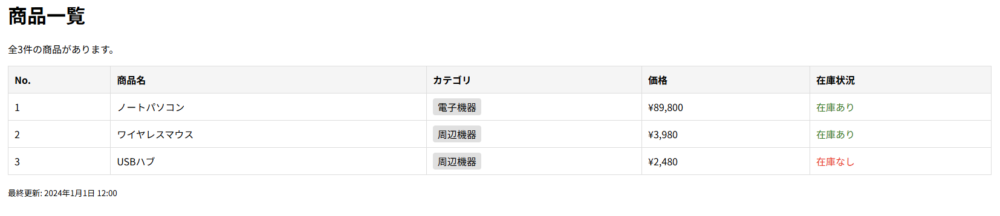

# blade-app-practice

## 概要
COACHTECH 教材 Tutorial 9-2「Bladeテンプレート ハンズオン演習」で作成した成果物です。
提供されたのBladeファイルの変数名や使われ方を確認し、対応したルーティングやコントローラーを作成しました。

## 使用技術
- PHP 8.5.12
- Laravel 10.50.3
- Blade テンプレート

## 学んだこと
- 提供されたBladeファイル内で必要な変数とその型などを確認し、コントローラーから渡す方法
- @ifによる条件分岐と、@forelseによる値がなかった場合も考慮したループ処理
- 複数のオブジェクトをまとめたコレクションを定義する方法

## 動作確認
1. blade-app-practiceディレクトリ上でsail up -dによりyamlファイルに記述した構成通りのコンテナを起動させてネットワークで連携
2. VSCode上でPHPファイルを編集して保存
3. ブラウザで「`http://localhost/products`」のURLにアクセスして商品一覧ページが表示されることを確認
4. VSCodeでの編集を保存して、「`http://localhost/products`」のリロードにより編集内容を確認

## 詰まったポイントと解決方法
- Bladeファイル内で「$products->count()」というメソッド実行の記述があったため、$productsをコレクションとして定義した
- Bladeファイル内で「$product->name」のようにオブジェクトのプロパティを参照するような記述があったため、各商品情報をオブジェクトとして定義した

## 開発の工夫
- Bladeファイルで必要な変数を確認した後、コントローラー内で各変数を1つずつ定義するより、先に必要な変数を列挙しておくことで、定義が必要な変数を把握したうえで定義を進められた

## 動作確認のスクリーンショット
「`http://localhost/products`」にアクセスした時の商品一覧画面
